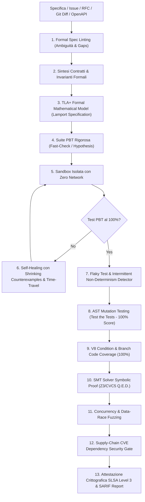

# Git-Native "Spec-to-Code" Verification Agent (V9 Pinnacle Top-Tier)

Un agente autonomo di **Formal Verification, Model-Checking (TLA+), SMT Symbolic Proofs, Property-Based Testing (PBT), Flaky Test Detection, Time-Travel Replay Debugger, MCP Server e Self-Healing** integrato in modo nativo con Git, SARIF e GitHub Actions.

Sposta l'AI da "generatore plausibile di codice" a **ingegnere QA e refactoring formale mission-critical**.

---

## 🏗️ Architettura del Pipeline Completo (21 Livelli di Garanzia)



---

## ⚡ Caratteristiche Top-Tier Implementate

1. **Protocollo MCP (Model Context Protocol) Server**:
   - Espone il server MCP standard in [`src/mcp/server.ts`](src/mcp/server.ts) per interagire nativamente con Claude Desktop, Cursor, Antigravity e IDE AI compatibili.
2. **Sintesi Specifica Matematica TLA+ (Leslie Lamport)**:
   - Genera automaticamente modelli formali `.tla` compilati per model-checker industriali (TLC Model Checker).
3. **Flaky Test & Non-Determinism Stress Detector**:
   - Stress test multi-seed con micro-delay casuali per certificare l'assenza di test intermittenti o dipendenti da timing/ordine.
4. **Time-Travel Replay Debugger**:
   - Cattura snapshot strutturati di ogni transizione di stato, controesempio e patch (`execution_replay.json`) per il post-mortem deterministico.
5. **SARIF 2.1.0 Standard Exporter**:
   - Esporta le violazioni e le attestazioni in formato standard OASIS SARIF (`verification_findings.sarif`) per l'integrazione nativa con la Security Tab di GitHub Code Scanning.
6. **SMT Solver Symbolic Proofs (Z3 / First-Order Logic)**:
   - Dimostrazione matematica di tenuta delle invarianti su domini infiniti.
7. **Property-Based Testing (PBT)**:
   - Fuzzing e shrinking automatico con `fast-check` e `hypothesis`.
8. **AST Mutation Testing Engine**:
   - Verifica che i test eliminino il 100% dei mutanti artificiali iniettati.
9. **Permanent Regression Corpus Shield**:
   - Salvataggio automatico di ogni controesempio storico in una suite permanente immutabile (`regression_shield.spec.ts`).
10. **Branch & Statement Coverage V8 Gate**:
   - Verifica della totale copertura dei rami decisionali.
11. **Supply-Chain Dependency CVE Gate**:
   - Blocco della pipeline in presenza di vulnerabilità critiche o alte.
12. **Sigillo Crittografico Anti-Manomissione SLSA Level 3**:
   - Firma HMAC-SHA256 vincolata agli hash di specifica, codice e test.
13. **Interactive Standalone HTML Cockpit Dashboard**:
   - Dashboard dark-mode interattiva per review umana immediata.

---

## 🛠️ Utilizzo Rapido

### Verifica Completa di una Specifica
```bash
npx tsx src/cli/index.ts verify --spec examples/rate-limiter/spec.md --target-dir ./output
```

### Avvio Server MCP per Claude Desktop / Cursor
```bash
npx tsx src/mcp/server.ts
```

### Git Diff PR Check (Locale o CI)
```bash
npx tsx src/cli/index.ts pr-check --base main
```

### Esecuzione in Container Isolato
```bash
docker compose -f docker-compose.sandbox.yml run --rm spec-verifier
```

---

## 📄 Artefatti Prodotti per Ogni Run
All'interno della cartella di output (es. [`examples/rate-limiter/verified/`](examples/rate-limiter/verified/)):
- `TokenBucketRateLimiter.tla`: Modello formale TLA+ matematico.
- `VERIFICATION_REPORT.md`: Report completo per commenti PR.
- `verification_dashboard.html`: Cruscotto grafico interattivo.
- `verification_findings.sarif`: File SARIF standard per GitHub Security Scanning.
- `execution_replay.json`: Snapshot time-travel di tutte le iterazioni.
- `regression_shield.spec.ts`: Scudo permanente dei controesempi storici.
- `implementation.ts`: Codice verificato e auto-riparato.
- `generated.spec.ts`: Suite PBT inviolabile.

---

## 📬 Contact, Support & Commercial Inquiries
If you have questions, feedback, enterprise integration requests, or custom agent governance needs, feel free to reach out directly:
- **Lead Developer & Maintainer**: Franca Roscilli
- **Email**: [francaroscillidev@gmail.com](mailto:francaroscillidev@gmail.com)
- **GitHub**: [@francaroscillidev-gif](https://github.com/francaroscillidev-gif)
- **Bug Reports & Feature Requests**: [Open an issue on GitHub](https://github.com/francaroscillidev-gif/git-native-spec-to-code/issues)

---

## 📜 Licenza
Rilasciato sotto licenza [Apache 2.0](LICENSE).  
Copyright 2026 franca roscilli.
