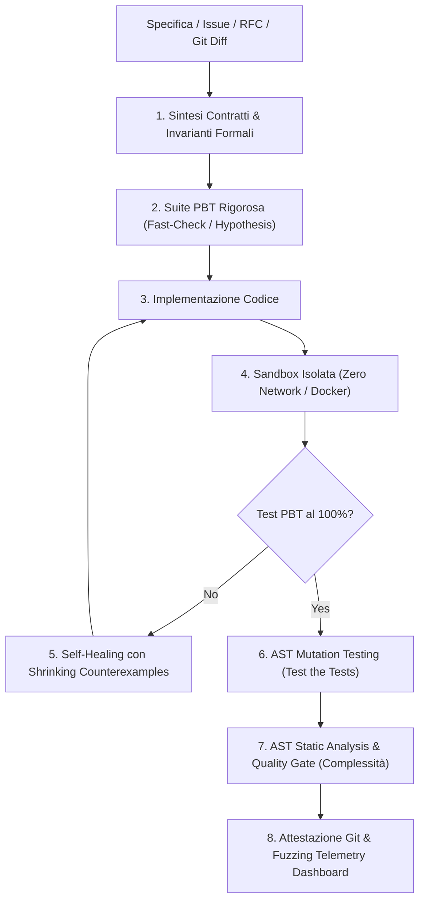

# Git-Native "Spec-to-Code" Verification Agent (V3 Enterprise)

Un agente autonomo di **Formal Verification, Property-Based Testing (PBT), AST Mutation Testing, Static Analysis e Self-Healing** integrato in modo nativo con Git e GitHub Actions.

Sposta l'AI da "generatore plausibile di codice" a **ingegnere QA ad altissima affidabilità deterministica**.

---

## 🏗️ Architettura del Pipeline Completo



---

## ⚡ Caratteristiche Implementate

1. **Property-Based Testing (PBT)**: Sintesi automatica di invarianti matematiche, monotonicità, bounds checking e conservazione dello stato.
2. **Determinismo & Shrinking**: Isolamento del *minimal failing counterexample* (ad es. `[10, 1, 100]`) per guidare la correzione atomica.
3. **AST Mutation Testing Integrato**: Generazione ed esecuzione di mutanti su operatori logici/aritmetici. Calcolo del *Mutation Score* per garantire l'assenza di test tautologici.
4. **AST Static Code Auditor**: Calcolo della Complessità Ciclomatica per impedire codice "spaghetti" o non manutenibile.
5. **Git-Native PR Regression Guard**: Comando `pr-check` per il controllo automatico delle modifiche differenziali rispetto a `main`.
6. **Multi-Language Sandbox**:
   - TypeScript/JavaScript (`fast-check` + `vitest`)
   - Python (`hypothesis` + `pytest`)
7. **Isolamento Containerizzato**: Supporto per Docker e Docker Compose con network disabilitato (`network_mode: "none"`).

---

## 🛠️ Utilizzo Rapido

### Verifica Completa di una Specifica
```bash
npx tsx src/cli/index.ts verify --spec examples/rate-limiter/spec.md --target-dir ./output
```

### Git Diff PR Check (Locale o CI)
```bash
npx tsx src/cli/index.ts pr-check --base main
```

### Esecuzione in Container Isolato
```bash
docker compose -f docker-compose.sandbox.yml run --rm spec-verifier
```

---

## 📄 Esempio di Report di Sicurezza Generato
Il report formale pronto per la PR include lo stato PBT, il punteggio di Mutation Testing, l'audit di complessità ciclomatica e la telemetria di Fuzzing con seed deterministico: vedi [VERIFICATION_REPORT.md](examples/rate-limiter/verified/VERIFICATION_REPORT.md).
