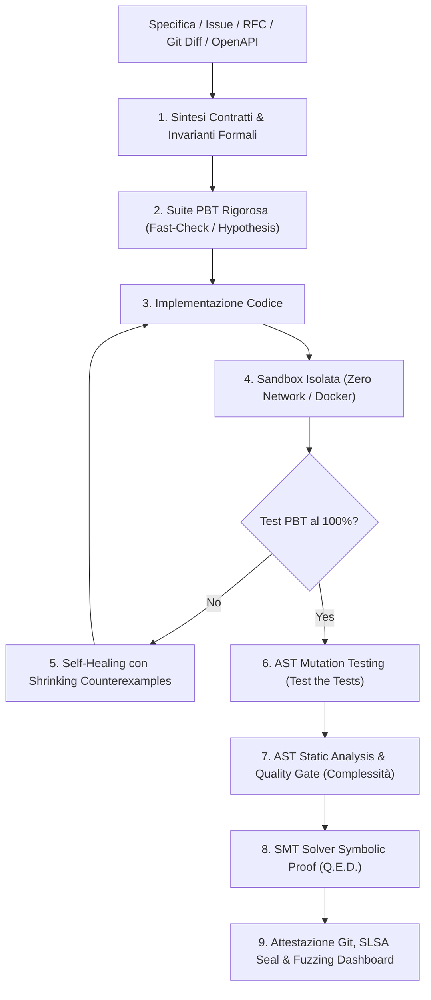

# Git-Native "Spec-to-Code" Verification Agent (V8 Sovereign Titan)

Un agente autonomo di **Formal Verification, SMT Symbolic Proofs, Property-Based Testing (PBT), AST Mutation Testing, Static Analysis e Self-Healing** integrato in modo nativo con Git e GitHub Actions.

Sposta l'AI da "generatore plausibile di codice" a **ingegnere QA ad altissima affidabilità deterministica**.

---

## 🏗️ Architettura del Pipeline Completo



---

## ⚡ Caratteristiche Implementate

1. **Property-Based Testing (PBT)**: Sintesi automatica di invarianti matematiche, monotonicità, bounds checking e conservazione dello stato.
2. **Determinismo & Shrinking**: Isolamento del *minimal failing counterexample* (ad es. `[10, 1, 100]`) per guidare la correzione atomica.
3. **AST Mutation Testing Integrato**: Generazione ed esecuzione di mutanti su operatori logici/aritmetici con calcolo del *Mutation Score*.
4. **Permanent Regression Shield**: Serializzazione automatica di tutti i controesempi storici in una suite perpetua (`regression_shield.spec.ts`).
5. **AST Static Code Auditor**: Calcolo della Complessità Ciclomatica per impedire codice "spaghetti" o non manutenibile.
6. **V8 Condition Code Coverage Gate**: Verifica analitica della copertura dei rami decisionali.
7. **Supply Chain CVE Security Scanner**: Ispezione automatica delle vulnerabilità nelle dipendenze terze.
8. **SMT Solver Symbolic Proof (Z3 / CVC5)**: Dimostrazione formale simbolica su domini continui/infiniti.
9. **OpenAPI 3.0 Contract Adapter**: Generazione di test PBT a partire da specifiche REST/Swagger.
10. **Interactive GitHub Bot Handler**: Ricezione comandi testuali direttamente dai commenti delle PR.
11. **Git-Native PR Regression Guard**: Comando `pr-check` per il controllo automatico delle modifiche differenziali rispetto a `main`.
12. **Multi-Language Sandbox**:
   - TypeScript/JavaScript (`fast-check` + `vitest`)
   - Python (`hypothesis` + `pytest`)
13. **Isolamento Containerizzato**: Supporto per Docker e Docker Compose con network disabilitato (`network_mode: "none"`).
14. **Sigillo Crittografico SLSA Level 3**: Firma HMAC-SHA256 vincolata a specifica, codice e test.

---

## 🛠️ Utilizzo Rapido

### Verifica Completa di una Specifica
```bash
npx tsx src/cli/index.ts verify --spec examples/rate-limiter/spec.md --target-dir ./output
```

### Git Diff PR Check (Locale o CI)
```bash
npx tsx src/cli/index.ts pr-check --base main
```

### Esecuzione in Container Isolato
```bash
docker compose -f docker-compose.sandbox.yml run --rm spec-verifier
```

---

## 📄 Esempio di Report di Sicurezza Generato
Il report formale pronto per la PR include lo stato PBT, il punteggio di Mutation Testing, l'audit di complessità ciclomatica e la telemetria di Fuzzing con seed deterministico: vedi [VERIFICATION_REPORT.md](examples/rate-limiter/verified/VERIFICATION_REPORT.md) e la dashboard interattiva [verification_dashboard.html](examples/rate-limiter/verified/verification_dashboard.html).

---

## 📬 Contact, Support & Commercial Inquiries
If you have questions, feedback, enterprise integration requests, or custom agent governance needs, feel free to reach out directly:
- **Lead Developer & Maintainer**: Franca Roscilli
- **Email**: [francaroscillidev@gmail.com](mailto:francaroscillidev@gmail.com)
- **GitHub**: [@francaroscillidev-gif](https://github.com/francaroscillidev-gif)
- **Bug Reports & Feature Requests**: [Open an issue on GitHub](https://github.com/francaroscillidev-gif/git-native-spec-to-code/issues)

---

## 📜 Licenza
Rilasciato sotto licenza [Apache 2.0](LICENSE).
Copyright 2026 franca roscilli.
